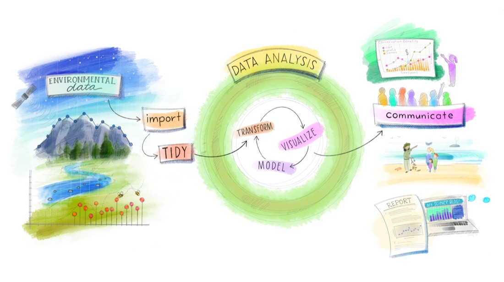
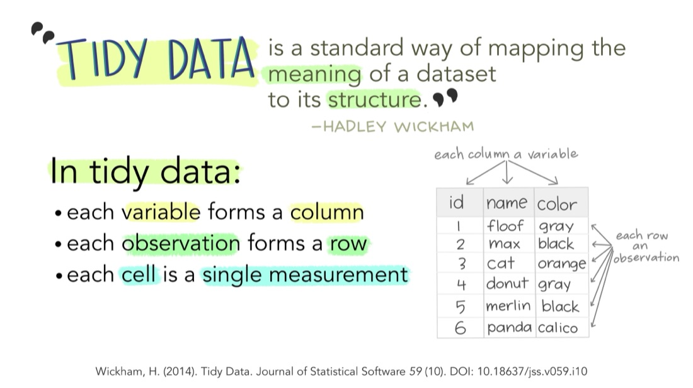
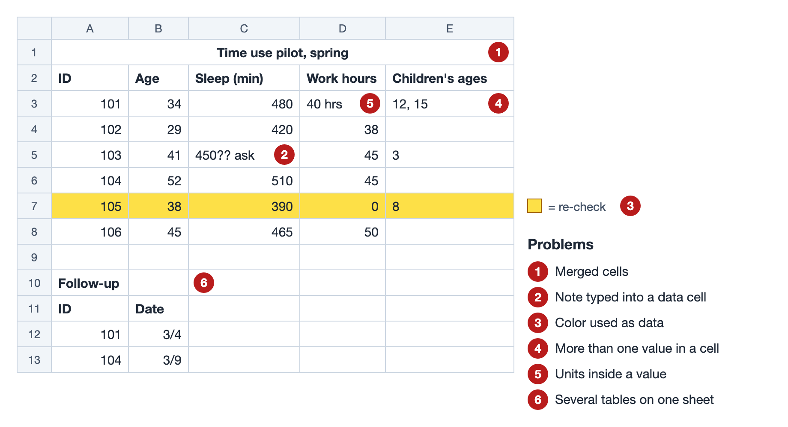
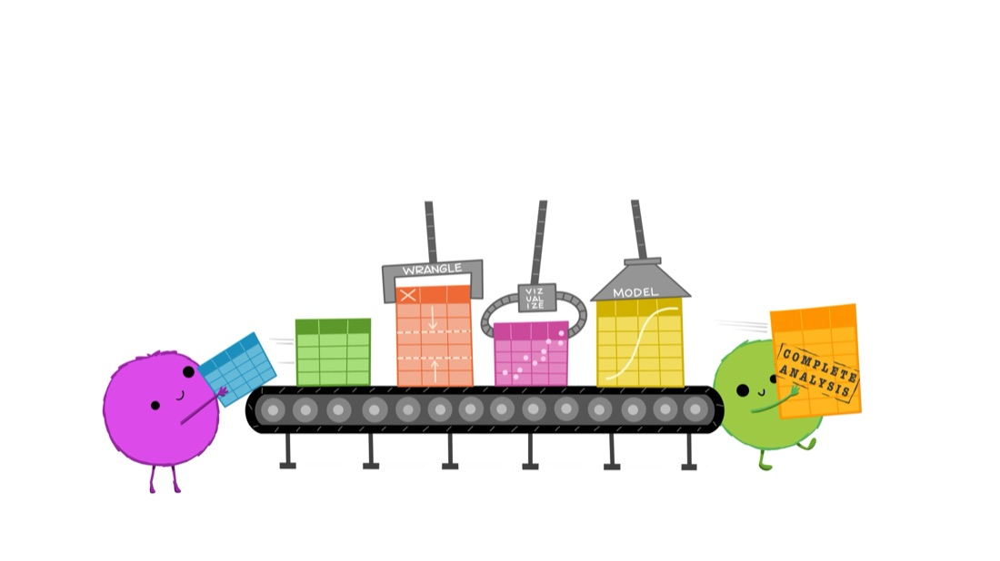
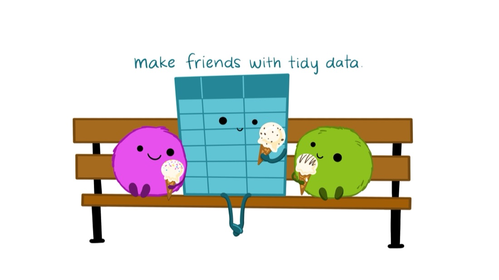

<!-- Basic text deck for the opening and closing of the session. The text gets copied into the
DSTI slide template, so keep formatting plain. Everything between the opening and the closing
happens in the guide and in Google Sheets, not on slides. Links marked TBD get filled in once the
guide and workbook exist. -->

## Data Science Services

- Free consultations, workshops and data help for everyone at NC State
- Get Data Help: go.ncsu.edu/getdatahelp
- Data requests: getdatahelp@ncsu.edu

::: notes
Introduce the facilitators and helpers in the room. Mention that helpers can come to anyone who
gets stuck, so raise a hand rather than waiting.
:::

## Today you will learn to

1. Describe tidy, rectangular data, and say when a spreadsheet is (and isn't) the right tool
2. Set up a workbook that keeps raw data untouched and records your changes
3. Use a data dictionary to rename columns, recode values and write validation rules
4. Find and fix common data problems
5. Write formulas that create new variables
6. Summarize data with summary functions and pivot tables
7. Make and customize charts that show a distribution, not just an average

## How today works

- **The guide** is the web page we work from: go.ncsu.edu/TBD
  - Every step is written out, with screenshots
  - It stays online, so you can use it as a reference later
- **The checklist** is a printed copy of just the steps. Tick them off as you go.
- **The workbook** is a Google Sheet. You'll make your own copy in a few minutes.
- Fall behind? Each section of the guide links a catch-up copy of the workbook.

::: notes
Point out that we stay in the guide and in Sheets for almost the whole session. These slides come
back only at the end.
:::

## Our data: the American Time Use Survey

- From the U.S. Bureau of Labor Statistics, collected every year since 2003
- Each respondent describes one day, activity by activity, with how many minutes each took
- We use a sample of 2,000 respondents and a few of the activities
  - Household chores: cleaning, laundry, preparing food, kitchen clean-up
  - Leisure: reading, games, TV and movies, socializing
- Source: bls.gov/tus

::: notes
Update the row count and the list of variables once the re-pulled file is final. Mention that the
numbers we get describe this sample, not the US population: ATUS provides weights that we won't
use today.
:::

## Our question gets sharper as we go

1. Who is in this data, and how many?
2. Can we trust these values?
3. How much of a day goes to chores, and how much to leisure?
4. Does leisure time change with age?
5. Do people with more children trade leisure for chores?
6. People with more education report less leisure. Is that about education, or about work?
7. How do we show the answer?

::: notes
Each section of the guide opens with one of these. Question 6 is the payoff: the answer depends
on a cleaning decision we make in the middle of the session.
:::

## Where today fits

{fig-alt="A watercolor diagram: data flows through import and tidy into a loop of transform, visualize and model, then out to communicate." width="85%"}

[Artwork from @juliesquid for @openscapes (illustrated by @allison_horst), CC BY 4.0.]{.credit}

## What spreadsheets are good at

- Looking at your data, row by row
- Entering and checking data, with rules that catch mistakes
- Quick fixes, summaries and charts
- Sharing and working on data together

## Where spreadsheets fall short

- Point-and-click steps aren't recorded, so they're hard to repeat or check
- Large datasets get slow
- Advanced statistics and many chart types aren't built in
- Today's habit that helps: keep the raw data untouched, and write down every change

::: notes
This is not "spreadsheets are bad". Many research projects start in a spreadsheet and move to R
or Python later. Everything we do today makes that move easier. The R and Python tracks are
running at the same time today.
:::

## Words we'll use

- **Workbook**: the whole file
- **Sheet**: one tab in the workbook
- **Cell**: one box; **range**: a block of cells, such as A2:A2001
- **Row** and **column**; the **header** is the first row, with the column names
- **Formula bar**: shows what's really in a cell, which may differ from what's displayed

## Tidy data

- Each **variable** is a column
- Each **observation** is a row
- Each **value** is a cell
- Each table is its own sheet

In our data, one row = one survey respondent.

## Tidy data, drawn

{fig-alt="Hand-lettered slide: in tidy data, each variable forms a column, each observation forms a row, and each cell is a single measurement, with a small table of cats." width="80%"}

[Illustration from Tidy Data for reproducibility, efficiency, and collaboration, by Julia Lowndes and Allison Horst (Openscapes), CC BY 4.0.]{.credit}

::: notes
Source: Wickham (2014), Tidy Data; Broman and Woo (2018), Data Organization in Spreadsheets.
:::

## Wide and long

{fig-alt="Animation: a wide table with columns id, x, y and z reshapes into a long table with columns id, key and val, and back." height="420"}

[Animation by Garrick Aden-Buie (tidyexplain), CC0. The code shown is R's.]{.credit}

- Both can be tidy
- Long is what most analysis tools expect for repeated measurements
- Choose on purpose, before you start entering data

## Common problems

{fig-alt="A small untidy spreadsheet with six numbered problems: a merged title cell, a note in a data cell, a yellow highlighted row, two values in one cell, units inside a value, and a second table below the first."}

::: notes
Color as data deserves a sentence: color doesn't survive export to CSV, and formulas and filters
can't read it. If something matters, it goes in a column.
:::

## How Sheets reads what you type

- Numbers line up on the **right**
- Text lines up on the **left**
- So a "number" on the left is stored as text, and calculations will skip it
- This is your first, fastest check of any column

## Let's start: make your copy

1. Open the workbook link in the guide: go.ncsu.edu/TBD
2. File > **Make a copy**
3. Name it "[Your name] DSTI spreadsheets"

From here, we work in the guide and in Sheets.

::: notes
Wait until most of the room has a copy open. Helpers go to anyone not signed in to their NC State
Google account. Fallback: download the CSV from the guide and use File > Import in a blank sheet.
:::

# Wrapping up

## Take your data with you

- File > Download > **Comma-separated values (.csv)**: the current sheet
- CSV opens in R, Python, SPSS, Stata and almost everything else
- Keep the README sheet with it: the data dictionary and your cleaning log

## What we did today

- Kept the raw data untouched and worked on a copy
- Used the data dictionary to rename, recode and set validation rules
- Cleaned text, spaces, missing-value codes, out-of-range values and duplicates
- Made new variables with formulas
- Summarized with pivot tables
- Charted distributions: a scatter with a trendline, and a grouped histogram

The big lesson: **cleaning decisions change conclusions.** Write them down.

## From raw to analysis

{fig-alt="Tables on a conveyor belt pass under machines labeled wrangle, visualize and model, and come out stamped complete analysis." width="80%"}

[Illustration from Tidy Data for reproducibility, efficiency, and collaboration, by Julia Lowndes and Allison Horst (Openscapes), CC BY 4.0.]{.credit}

## Where to go next

- **R or Python**: when you need steps you can repeat, larger data or more statistics
- **Charts Sheets can't make** (box plots, violin plots, custom error bars): Looker Studio,
  Google Colab or Excel. See the table in the guide.
- **Design better charts**: the DSS data visualization workshop
- **Practice**: the extra activities at the end of the guide

## Resources

- The guide (stays online): go.ncsu.edu/TBD
- Data Organization in Spreadsheets for Social Scientists (The Carpentries):
  carpentry.library.ucsb.edu/spreadsheets-socialsci
- Broman, K. W., and Woo, K. H. (2018). Data Organization in Spreadsheets. *The American
  Statistician*, 72(1), 2–10.
- American Time Use Survey: bls.gov/tus

## Thank you

{fig-alt="Two furry creatures and a smiling table share ice cream on a park bench, under the words make friends with tidy data." width="55%"}

- Get Data Help: go.ncsu.edu/getdatahelp
- Data requests: getdatahelp@ncsu.edu
- Please fill out the evaluation: TBD

[Illustration from Tidy Data for reproducibility, efficiency, and collaboration, by Julia Lowndes and Allison Horst (Openscapes), CC BY 4.0.]{.credit}
