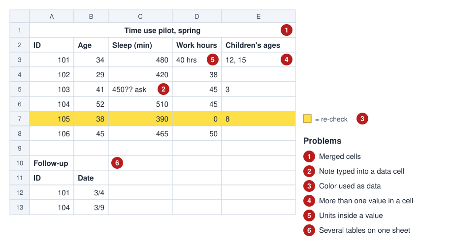
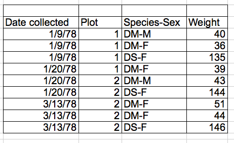
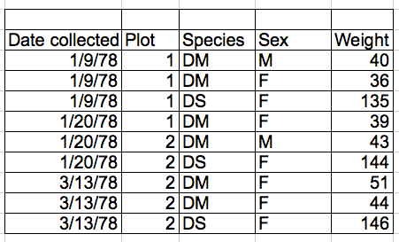
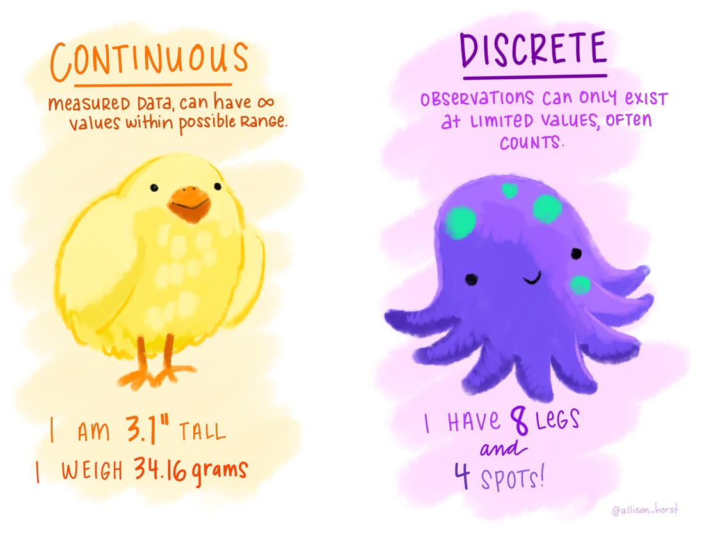
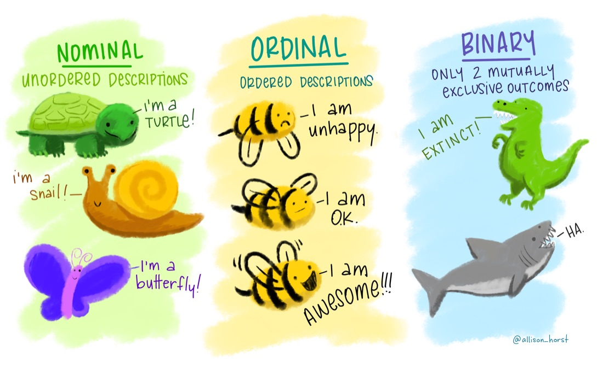
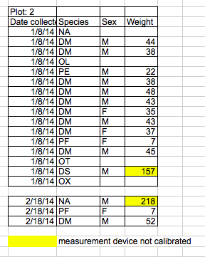
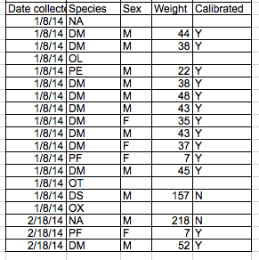

<!--
DRAFT SKELETON (Oct 1). Conventions while drafting:
- [text]{.tbd} marks a number or column letter that waits for the re-pulled data. Search for
  "{.tbd}" before release; none should remain.
- ::: {.placeholder} blocks mark screenshots and GIFs to take. Each names its file in images/.
  Search for "placeholder" for the full list.
- Column letters follow the provisional layout in "What's in the workbook" (section 2). If the
  layout changes, update that table first, then every formula.
- After a set of steps, only "Gotcha: ..." (callout-warning) and "Extra: ..." (callout-tip)
  callouts, as in mapping-r.
-->

::: {.placeholder}
**Draft.** Column letters, row counts and results highlighted [like this]{.tbd} are provisional
until the final dataset is ready. Dashed boxes like this one mark screenshots still to take.
:::

::: callout-important
## How to use this guide

This is the page we work from in the session. Every step is written out, so you can follow along,
catch up if you fall behind, and come back to it later.

- **Work in your own copy of the workbook.** @sec-setup shows you how to make one.
- **Fell behind?** Each section ends with a link to a catch-up copy of the workbook as it should
  look at that point.
- **Printed checklist:** the steps without the explanations, to tick off as you go.
  [Open the checklist](https://ncsu-libraries.github.io/intro-spreadsheets/spreadsheets-checklist.html), and print it from your browser.
:::

# Welcome {.unnumbered}

Spreadsheets are where a lot of research data starts: survey exports, lab measurements, field
sheets, downloads from a database. Before you can analyze that data you have to understand it,
clean it and reshape it. Today we do all of that in Google Sheets with a real dataset, the American
Time Use Survey, and use it to answer one question that gets sharper as we go:

**How do people split their day between household chores and leisure?**

By the end of this session you will be able to:

1. Describe tidy, rectangular data, and say when a spreadsheet is (and isn't) the right tool.
2. Set up a workbook that keeps raw data untouched and records your changes.
3. Use a data dictionary to rename columns, recode values and write validation rules.
4. Find and fix common data problems: inconsistent text, extra spaces, numbers stored as text,
   missing-value codes, out-of-range values and duplicates.
5. Write formulas that create new variables.
6. Summarize data with summary functions and pivot tables.
7. Make and customize charts that show a distribution, not just an average.

## The questions we'll answer {.unnumbered}

| | Question | Where |
|---|---|---|
| 1 | Who is in this data, and how many? | @sec-intro, @sec-setup |
| 2 | Can we trust these values? | @sec-entry to @sec-clean |
| 3 | How much of a day goes to chores, and how much to leisure? | @sec-variables, @sec-explore |
| 4 | Does leisure time change with age? | @sec-explore, @sec-visualize |
| 5 | Do people with more children trade leisure for chores? | @sec-explore, @sec-visualize |
| 6 | People with more education report less leisure. Is that about education, or about work? | @sec-explore |
| 7 | How do we show the answer? | @sec-visualize |

## About the data {.unnumbered}

The [American Time Use Survey](https://www.bls.gov/tus/) (ATUS) is collected every year by the
U.S. Bureau of Labor Statistics. Each respondent describes one day, activity by activity, and the
survey records how many minutes they spent on each kind of activity. Our workbook has a random
sample of 2,000 respondents from 2003–2023, with a few demographic columns and a
few activities.

Two things to keep in mind about any result we get today:

- **It describes this sample, not the US population.** ATUS supplies survey weights to make
  national estimates; we don't use them.
- **Each person reports one day.** Someone who did no laundry on their diary day may do plenty on
  other days.

------------------------------------------------------------------------

# Spreadsheets for research {#sec-intro}

> **Question 1:** Who is in this data, and how many?

Researchers use spreadsheets to collect data, prepare it for analysis, take a first look at it and
share it with collaborators. Spreadsheets are very good at letting you *see* your data. They are
weaker at keeping a record of what you did: a click-and-drag change leaves no trace, so it's hard
to repeat or to check later. That's why R and Python (the other two tracks today) exist, and why
two habits in this session matter so much: **never edit the raw data, and write down every
change.**

.](images/intro-workflow.jpg){fig-alt="A watercolor diagram. Environmental data on the left flows through 'import' and 'tidy' into a circle labeled data analysis, containing transform, visualize and model with arrows between them. An arrow leads out to 'communicate', with pictures of a presentation, a report and a blog." width="90%"}

## Words we'll use

- **Workbook:** the whole file.
- **Sheet:** one tab in the workbook.
- **Cell:** one box, named by column and row (B7). A **range** is a block of cells (A2:A2001).
- **Row** and **column.** The **header** is the first row, which holds the column names.
- **Formula bar:** the bar above the sheet that shows what's really in a cell. A cell can *show*
  "2.01E+13" while *storing* 20070112060976.

::: {.placeholder}
**Screenshot** `images/intro-sheets-anatomy.png`: a Google Sheets window with workbook name,
sheet tabs, a selected cell, a range, the header row and the formula bar labeled.
:::

## Tidy data

Analysis tools, including spreadsheet features like pivot tables, expect data laid out in one way:

- Each **variable** is a column.
- Each **observation** is a row.
- Each **value** is a cell.
- Each table is its own sheet.

In our data, one row is one survey respondent, and each column is one thing we know about them.

 by Julia Lowndes and Allison Horst, [CC BY 4.0](https://creativecommons.org/licenses/by/4.0/).](images/intro-tidy-rules.jpg){fig-alt="Hand-lettered slide: 'Tidy data is a standard way of mapping the meaning of a dataset to its structure,' quoting Hadley Wickham. In tidy data each variable forms a column, each observation forms a row, and each cell is a single measurement. A small table of cats with id, name and color columns has arrows marking a column as a variable and each row as an observation." width="85%"}

Tidy data is worth the effort because every tidy table works with the same tools in the same way.
Untidy data needs a new workaround every time.

 by Julia Lowndes and Allison Horst, [CC BY 4.0](https://creativecommons.org/licenses/by/4.0/).](images/intro-tidy-workbench.jpg){fig-alt="Two workbenches. On the left, a tidy data workbench with neatly hung tools labeled read, visualize, wrangle and model, and a happy furry creature. On the right, an untidy data workbench with a tangle of odd tools, rope and tape, and a stressed creature gluing a broken table together." width="90%"}

### Wide and long

The same data can be tidy in more than one shape. Say you measure the height of five plants on
three days. **Wide** has one row per plant and one column per day. **Long** has one row per plant
per day, with a "day" column and a "height" column. Long is what most analysis tools expect for
repeated measurements, so choose the shape on purpose before you start entering data.

, [CC0](https://creativecommons.org/publicdomain/zero/1.0/).](images/intro-wide-long.gif){fig-alt="Animation. A wide table with an id column (1, 2) and columns x, y and z holding values a to f. The x, y and z cells slide down into a long table with columns id, key and val, six rows in all, while R code for pivot_longer shows at the top. It then reverses back to the wide table under R code for pivot_wider." width="45%"}

### Common problems

These all break the "one variable, one observation, one value" rules, and they all make data
harder to analyze:

- Merged cells.
- Notes typed into data cells ("about 40?").
- **Color used as data** (yellow rows = "check these"). Color doesn't survive saving as CSV, and
  formulas, filters and pivot tables can't read it. If something matters, put it in a column.
- More than one value in a cell ("12, 15").
- Units inside values ("40 hrs").
- Several tables on one sheet.

{fig-alt="A small spreadsheet titled 'Time use pilot, spring' with six numbered markers: 1, the title is a merged cell across the top row; 2, a sleep cell says '450?? ask'; 3, one row is highlighted yellow, with a key saying yellow means re-check; 4, a children's ages cell holds '12, 15'; 5, a work hours cell says '40 hrs'; 6, a second small table called Follow-up sits below the first." width="95%"}

One value per cell often means splitting a column in two:

::: {layout-ncol="2"}
{fig-alt="A table with columns Date collected, Plot, Species-Sex and Weight, where Species-Sex holds values like DM-M and DS-F."}

{fig-alt="The same table with separate Species and Sex columns, holding DM and M, DS and F, and so on."}
:::

From [Data Organization in Spreadsheets for Ecologists](https://datacarpentry.github.io/spreadsheet-ecology-lesson/), Data Carpentry, [CC BY 4.0](https://creativecommons.org/licenses/by/4.0/).

## How Sheets reads what you type

When you type into a cell, Sheets decides whether it's a number, a date or text. By default,
**numbers line up on the right and text on the left.** A "number" sitting on the left is stored as
text, and calculations will skip it. Glancing at alignment is the fastest first check of any
column.

------------------------------------------------------------------------

# Set up your workbook {#sec-setup}

The workbook has three sheets, and each has one job. Keeping them separate means you can always get
back to the original and see what you changed.

## Make your copy

1. Open the workbook: [DSTI ATUS Data Working](https://docs.google.com/spreadsheets/d/1A9IbG6Fm5DXdETl9tv0qm8pjV1LvKKRouo-V2oKVwF0/edit?usp=sharing). It opens view-only.
2. **File > Make a copy.** Name it "[Your name] DSTI spreadsheets" and click **Make a copy**. Your
   copy opens in a new tab.

::: {.placeholder}
**Screenshot** `images/setup-make-copy.png`: the File menu with Make a copy highlighted, and the
Make a copy dialog.
:::

::: {.callout-warning}
## Gotcha: "Make a copy" is greyed out or asks you to request access

You're probably signed in to a personal Google account, or not signed in. Switch to your NC State
account (top right of the window) and try again. If it still fails, download [the workbook file](https://github.com/NCSU-Libraries/intro-spreadsheets/raw/main/data/DSTI%20ATUS%20Data%20Working.xlsx), open a blank
sheet, and use **File > Import > Upload**.
:::

## What's in the workbook

- **README**: the data dictionary (what each column means and what its codes are) and a
  **cleaning log** where you'll record what you change.
- **raw**: the data as it came from ATUS. **Never edit this sheet.**
- **working**: a copy we'll clean and analyze. Some of it has already been tidied, the way you
  might receive data from a collaborator. The rest is up to you.

The `working` sheet's columns, for reference:

| Column | Header | What it is | Its state when you start |
|---|---|---|---|
| A | Case | Respondent ID | Shows in scientific notation (@sec-understand) |
| B | Diary Year | Year of the diary day | Ready |
| C | Diary Day | Day of the week of the diary day | Ready |
| D | Metropolitan | Lives in a metropolitan area? | Still coded as numbers (@sec-understand) |
| E | Education level | Highest degree | Extra spaces and spelling variants (@sec-clean) |
| F | Age | Age in years | One impossible value (@sec-clean) |
| G | Sex | Sex | Typos and inconsistent capitals (@sec-clean) |
| H | TRCHILDNUM | Number of children under 18 in household | Header not renamed (@sec-understand) |
| I | Labor force status | Employed, unemployed, or not in the labor force | Ready |
| J | Enrolled in school | Enrolled in high school, college or university. Asked only of ages 15–49; "Blank" means not asked | Ready (not used today) |
| K | TEHRUSLT | Hours usually worked per week | Header not renamed; uses missing codes (@sec-clean) |
| L | Sleep (mins) | Minutes sleeping on the diary day | Ready |
| M–P | Interior cleaning, Laundry, Food and drink prep, Kitchen clean-up (mins) | Household chores | Ready, except O (@sec-clean) |
| Q–R | Eating and Drinking, Grocery Shopping (mins) | Neither chores nor leisure | Ready |
| S–V | Reading, Playing games, TV and Movies, Socializing (mins) | Leisure | Ready |

: The `working` sheet's columns. New columns you make go to the right, starting at W.

::: {.placeholder}
**Screenshot** `images/setup-three-sheets.png`: the bottom of the window showing the README, raw
and working tabs.
:::

## Find your way around the data

1. Click the **working** tab.
2. **View > Freeze > 1 row.** The header now stays in view as you scroll.
3. Click any cell in column A, then press **Ctrl + ↓** (Mac: **Cmd + ↓**) to jump to the last row.
   The row number tells you how many respondents there are (one less than the row number, because
   of the header). Press **Ctrl + ↑** (Mac: **Cmd + ↑**) to jump back.

::: {.placeholder}
**GIF** `images/setup-freeze-jump.gif`: freezing the header row, then jumping to the last row and
back.
:::

The last row is 2007, so there are 2,006 rows of data. That answers question 1, almost: are they
2,006 different people? @sec-clean finds out.

**Selecting down to the last row.** This guide writes a range that runs from a cell to the bottom of
its column like this: **W2:W** means "W2 and everything below it". To select one:

- Click the first cell (W2), then press **Ctrl + Shift + ↓** (Mac: **Cmd + Shift + ↓**). The
  selection runs down to the last filled cell. This works when the column has no empty cells.
- Or type the range (`W2:W`) in the **Name box** at the top left, just left of the formula bar, and
  press **Enter**. [Confirm Name box behavior.]{.tbd}

::: {.callout-tip}
## Extra: protect the raw sheet

Right-click the **raw** tab > **Protect sheet**. You can then choose who may edit it, or have
Sheets warn anyone (including you) who tries. It's a guard against the classic accident of cleaning
the wrong sheet.
:::

::: {.callout-tip}
## Extra: version history

**File > Version history > See version history** shows every saved version of the workbook and
who changed what. You can name a version ("before cleaning") and restore it. Day 1 of the
intensive covered version control in more depth.
:::

------------------------------------------------------------------------

# Entering data well {#sec-entry}

> **Question 2:** Can we trust these values? (Sections 3 to 5.)

Most data problems start at data entry. Knowing what kind of data each column holds, and telling
Sheets what's allowed, catches mistakes before they spread. The same rules also find mistakes
already in the data.

## Kinds of data

- **Numeric:** continuous (sleep minutes) or discrete (number of children).
- **Categorical:** nominal (labor force status), ordinal (education level, which has an order),
  or binary (enrolled: yes or no).
- **Dates.**
- **IDs:** numbers you never do arithmetic on, like Case ID.

::: {layout-ncol="2"}
{fig-alt="Two painted animals. Continuous: measured data that can have infinite values within a possible range, shown by a chick saying 'I am 3.1 inches tall, I weigh 34.16 grams'. Discrete: observations that can only exist at limited values, often counts, shown by an octopus saying 'I have 8 legs and 4 spots'."}

{fig-alt="Three columns of painted animals. Nominal, unordered descriptions: a turtle, a snail and a butterfly. Ordinal, ordered descriptions: three bees saying 'I am unhappy', 'I am OK' and 'I am awesome'. Binary, only two mutually exclusive outcomes: a dinosaur saying 'I am extinct' and a shark saying 'Ha'."}
:::

Artwork by [Allison Horst](https://github.com/allisonhorst/stats-illustrations), [CC BY 4.0](https://creativecommons.org/licenses/by/4.0/).

## Dates

Sheets stores a date as a number: the count of days since 30 December 1899. That's what lets you
subtract one date from another. Two habits keep dates safe:

- **Type dates as YYYY-MM-DD** (2007-01-12). Sheets reads that form the same way everywhere.
  "01/12/2007" means 12 January in some countries and 1 December in others, and Sheets follows the
  spreadsheet's locale setting (**File > Settings**).
- **Keep a date as one date column,** or as separate year, month and day columns, but decide on
  purpose.

, [CC BY-NC 2.5](https://creativecommons.org/licenses/by-nc/2.5/).](images/entry-dates-iso8601.png){fig-alt="A comic titled 'Public service announcement'. It says that because different ways of writing dates as numbers cause confusion, ISO set a global standard in 1988, and the correct way to write numeric dates is 2013-02-27. Below, a long list of discouraged formats includes 02/27/2013, 27/02/2013, 20130227, 2013.02.27 and several joke formats, with a cat hissing at one of them." width="45%"}

Try it: in an empty cell on a new sheet, type `2007-01-12`, then use **Format > Number > Number**.
You'll see 39094, the day count. Undo with **Ctrl/Cmd + Z**.

## Validation rules from the data dictionary

**Data validation** tells Sheets what a column is allowed to hold. With a rule in place, a new
entry that breaks it is flagged or refused. A rule applied to data you already have flags every
cell that breaks it, which turns the data dictionary into a checklist.

1. On **README**, look up the allowed values for Sex and the allowed range for Age.
2. On **working**, select **G2:G** (all of Sex below the header: click G2, then
   **Ctrl/Cmd + Shift + ↓**).
3. **Data > Data validation > Add rule.**
4. Criteria: **Dropdown**. Add the two allowed labels from the README, `Female` and `Male`, one per
   item.
5. Open **Advanced options** and choose **Show a warning**. Click **Done**.
6. Add one more rule the same way: select **F2:F** (Age), criteria **Is between** 15 and 85.

The same kind of rule works for any range in the README, such as 0 to 1440 for minutes in a day.
Two rules are enough to see how it works.

Cells that break a rule now show a small red triangle in the corner. Hover over one to see why.
Leave them for now: they're the to-do list for @sec-clean.

::: {.placeholder}
**Screenshot** `images/entry-validation-rule.png`: the Data validation sidebar with the Age rule
filled in, Advanced options open.
:::

::: {.placeholder}
**Screenshot** `images/entry-validation-flags.png`: a few flagged cells with red triangles, one
hover message showing.
:::

::: {.callout-warning}
## Gotcha: "Show a warning" or "Reject the input"?

**Reject the input** stops anyone typing a bad value, which is what you want on a data entry form.
On existing data, use **Show a warning**: it flags problems without changing anything, so you
decide how to fix each one.
:::

::: {.callout-warning}
## Gotcha: dropdown chips change how the column looks

A dropdown rule shows each cell as a colored chip. That's display only; the value is unchanged.
To switch it off, choose **Display style: Plain text** in the rule's options.
[Confirm option name]{.tbd}
:::

::: {.callout-tip}
## Extra: tables

**Format > Convert to table** turns a range into a Sheets table, where each column has a type
(number, text, date, dropdown) and new rows follow it. It's a quick way to set up a data entry
sheet.
:::

------------------------------------------------------------------------

# Making data understandable {#sec-understand}

Before you can clean data, you have to know what it means. That starts with the data dictionary,
and with column names and values that a person can read.

## Read the data dictionary

Open **README** and read the row for each column: what it measures, its type, and what each code
means. Then compare it with the data. A dictionary that doesn't match its data is common, and it's
worth catching early.

## Rename columns

Good column names are short, consistent and include units: "Sleep (mins)", not "T010101" or
"How long did you spend sleeping". Two headers in `working` still have their ATUS codes.

If your data is headed for R or Python, names without spaces or brackets are easier to type
there. Pick one style and use it for every column.

, [CC BY 4.0](https://creativecommons.org/licenses/by/4.0/).](images/understand-name-cases.jpg){fig-alt="Illustration titled 'in that case'. A screaming snake labeled SCREAMING_SNAKE_CASE (upper snake), a kebab skewer labeled kebab-case (words on a skewer), a green snake labeled snake_case (lower snake), and a camel wearing headphones labeled camelCase, first word lower, capitalize all following words. A note says see also UpperCamel, aka PascalCase." width="75%"}

1. Click cell **H1** and type `Number of children`.
2. Click cell **K1** and type `Work hours per week`.
3. Add both changes to the cleaning log on **README**.

## Codes or labels?

Surveys usually store categories as numbers: 1 = Metropolitan, 2 = Non-metropolitan. Labels are
easier to read, and charts and pivot tables need them. Codes have their uses too:

- **Codes keep order.** Sorted as text, the days of the week come out Friday, Monday, Saturday…
  The codes 1–7 sort in the right order.
- **Some analysis software expects codes.**

A common approach is to keep both: a coded column and a labeled column. In `working`, most
columns already have labels. Metropolitan (column D) is still coded, so we'll recode it.

## Recode with Find and replace

The README gives Metropolitan's codes: 1 = Metropolitan, 2 = Non-metropolitan, 3 = Not identified,
-1 = blank (missing).

1. Click the column letter **D** to select the whole column.
2. **Edit > Find and replace** (Windows: **Ctrl + H**; Mac: **Cmd + Shift + H**).
3. **Find:** `-1`. **Replace with:** leave empty.
4. **Search:** **Specific range**, and check it says `working!D1:D` (or similar).
   [Confirm display]{.tbd}
5. Check **Match entire cell contents**.
6. **Replace all.** The dialog says how many cells changed.
7. Repeat for `1` → `Metropolitan`, `2` → `Non-metropolitan` and `3` → `Not identified`.
8. Log the recode on **README**.

::: {.placeholder}
**Screenshot** `images/understand-find-replace.png`: the Find and replace dialog with Specific
range, the E column range and Match entire cell contents checked.
:::

::: {.callout-warning}
## Gotcha: why -1 goes first, and why "Match entire cell contents" matters

Without **Match entire cell contents**, Find and replace changes text *inside* cells. Replacing
`1` would also change the 1 inside `-1`, giving "-Metropolitan". Doing `-1` first, with the box
checked, avoids both problems. The same mistake turns "Female" into "FeMale" if you replace
"male", or "Non-metropolitan" into "Non-Metro" if you shorten "Metropolitan".
:::

## Show IDs as whole numbers

Case IDs are 14-digit numbers, so Sheets shows them in scientific notation (2.00701E+13). The value
is fine; only the display is wrong.

1. Select column **A**.
2. **Format > Number > Custom number format.** Type `0` and click **Apply**.

::: {.callout-tip}
## Extra: recode with a lookup table

Recoding 16 education codes with Find and replace would take 16 passes. A lookup table does it in
one formula. See [Extra activities](#sec-extras).
:::

**Checkpoint (break).** You should have: your own copy, the header frozen, H and K renamed,
Metropolitan recoded, Case IDs as whole numbers, and red validation triangles still showing.
Catch-up copy: [link TBD]{.tbd}

------------------------------------------------------------------------

# Making data usable: cleaning {#sec-clean}

> **Question 2, continued:** Can we trust these values?

This is where most of the time in a real project goes. Each problem below is either flagged by a
validation rule from @sec-entry or easy to find with a filter. For each one, ask three things:
**what's wrong, what's the right fix, and how do I record it?**

## Filter, and filter views

A filter hides rows that don't match what you choose, so you can look at one group or one problem
at a time.

1. Click any cell in the data. **Data > Create a filter.** Each header gets a filter button.
2. Click the filter button on **Sex**. The list shows every distinct value in the column, which is
   the quickest way to spot typos and inconsistent spellings.
3. Choose **Filter by values** to tick the values you want, or **Filter by condition** for rules
   like "greater than 85".

::: {.placeholder}
**Screenshot** `images/clean-filter-values.png`: the Sex filter open, showing Femal, Mole, female and
MALE in the value list alongside Female and Male.
:::

::: {.callout-warning}
## Gotcha: a filter changes the view for everyone

In a shared workbook, a filter hides rows for every collaborator. A **filter view** (**Data >
Filter views > Create new filter view**) is yours alone, and you can save it and come back to it.
Use filter views when you share. [Confirm menu path]{.tbd}
:::

::: {.callout-warning}
## Gotcha: never sort one column on its own

Selecting one column and sorting it reorders that column only, so every value moves to the wrong
person. Sort with the filter button (**Sort A → Z**), or select the whole data range first.
:::

## Remove extra spaces

A space before or after a value is invisible, but " Bachelor's" and "Bachelor's" are different
values. Education level has a few of these: they show up as near-duplicates in its filter list.

, [CC BY 4.0](https://creativecommons.org/licenses/by/4.0/).](images/clean-extra-spaces.jpg){fig-alt="Illustration titled stringr::str_squish(): remove leading, trailing and repeated interior whitespace from strings. Four furry creatures push the words 'a cat' together, flinging away empty boxes that stand for the extra spaces before, between and after the words." width="75%"}

1. Select the data. **Data > Data cleanup > Trim whitespace.**

`=TRIM()` does the same in a helper column if you want to keep the original.

## Fix inconsistent text

Sex should have two values, but its filter list shows more: Female, Femal, female, Male, MALE and
Mole. In a pivot table, R or Python, each version can count as a group of its own.

**Typos** ("Femal", "Mole"): use Find and replace, as in @sec-understand.

1. Select column **G**. **Edit > Find and replace.**
2. **Find:** `Femal`. **Replace with:** `Female`. **Search:** **Specific range** (column G).
   Check **Match entire cell contents.** **Replace all.**
3. Repeat for `Mole` → `Male`.

::: {.callout-warning}
## Gotcha: "Femal" is inside "Female"

Without **Match entire cell contents**, replacing "Femal" with "Female" also changes every correct
"Female" into "Femalee". Check the box every time you recode.
:::

**Capitalization** ("female", "MALE"): use a formula in a helper column, then put the results back.

1. In **W1** type `helper`. In **W2** type `=PROPER(G2)`.
2. Fill down: double-click the **fill handle**, the small blue square at the bottom right of the
   selected cell. [Confirm: square or circle?]{.tbd} Sheets copies the formula down to the last row
   of the data.
3. Select **W2:W** (click W2, then **Ctrl/Cmd + Shift + ↓**), copy, click **G2**, then
   **Edit > Paste special > Values only**
   (**Ctrl/Cmd + Shift + V**). Start at row 2 so the header isn't overwritten.
4. Clear column W. Log the fix on **README**.

`UPPER()` and `LOWER()` work the same way. Pick one convention per column and stick to it.

**Spelling variants** in Education level ("Bachelors", "Masters"): open its filter list to find
them, then use Find and replace on column E (**Match entire cell contents** checked):
`Bachelors` → `Bachelor's` and `Masters` → `Master's`.

::: {.placeholder}
**GIF** `images/clean-proper-paste-values.gif`: the helper column, fill down, paste values only
back over G, clear W.
:::

::: {.callout-warning}
## Gotcha: why paste values only?

Column W contains formulas that point at G. If you pasted the formulas into G, they'd point at the
wrong cells and break. Pasting **values only** keeps the results and drops the formulas.
:::

::: {.callout-warning}
## Gotcha: `PROPER()` and apostrophes

`PROPER()` capitalizes the first letter after any character that isn't a letter, so "master's"
becomes "Master'S". That's why we use it on Sex and not on Education level. [Confirm in
Sheets.]{.tbd}
:::

[Case-sensitivity note: Sheets' `COUNTIF` ignores case, so it counts "female" and "Female"
together; check whether pivot tables do, and reword this section.]{.tbd}

## Fix numbers stored as text

Look at column **O** (food and drink prep). Some values sit on the left, with quotation marks around
them (`"30"`): they're text, and sums will skip them.

1. Select column O. **Edit > Find and replace.** Find `"` and replace with nothing, in this range
   only. **Replace all.**
2. **Format > Number > Number.** The values move to the right.

## Missing values: why and how

There's more than one kind of "missing", and they mean different things. Look at **Work hours per
week** (column K) and the README:

- **Empty cell:** no value recorded.
- **-1:** not asked. ATUS asks about work hours only of people who are employed, so -1 means the
  person isn't employed.
- **-4:** hours vary.
- **0:** a real zero.

To see why it matters, put these in two empty cells on a new sheet:

- `=AVERAGE(working!K2:K)`
- `=AVERAGEIF(working!K2:K, ">=0")`

The first treats -1 and -4 as numbers of hours and drags the average down: about 23 hours, against about 40 for
the people who reported their hours.

What to do with codes like these:

- **Keep the code, and flag it** in a column, so every analysis can include or exclude it on
  purpose. That's what we'll do.
- **Make it empty,** if no one will need the reason.
- **Fill in a value** (such as 0) only if that value is true. Replacing -1 with 0 would claim that
  people who aren't working work zero hours, which is close, but say so if you do it.

1. In **W1** type `Work hours missing`. In **W2** type `=OR(K2=-1, K2=-4)`.
2. Fill down. Each row now says TRUE or FALSE, a flag you can filter and count.
3. Log your decision on **README**.

::: {.callout-warning}
## Gotcha: a flag goes in a column, not in a color

Highlighting the -1 cells yellow would look helpful but can't be filtered, counted, or saved to
CSV. The TRUE/FALSE column can.
:::

::: {layout-ncol="2"}
{fig-alt="A small table of dates, species, sex and weight, with two weights highlighted yellow and a key at the bottom saying yellow means measurement device not calibrated. A plot number sits above the header and there is a blank row in the data."}

{fig-alt="The same table with no highlighting, a single header row, and a new Calibrated column holding Y or N for each row."}
:::

From [Data Organization in Spreadsheets for Ecologists](https://datacarpentry.github.io/spreadsheet-ecology-lesson/), Data Carpentry, [CC BY 4.0](https://creativecommons.org/licenses/by/4.0/).

## Values out of range: QA/QC

The red triangles on Age (from @sec-entry) mark values outside the allowed range. For a quick
overview of any column, select it and use **Data > Column stats**, which shows the minimum, maximum
and a distribution.

One example shows the whole process. For a flagged value, decide whether it's an error, a code, or
real:

- **Age 150:** impossible. An entry error. The **raw** sheet is the source here: find this Case
  there (**Ctrl/Cmd + F**) and you'll see the real age, 33. Correct it, and log it.
- **Age 80 and 85:** real, but not exact. ATUS *top-codes* age: everyone 80–84 is recorded as 80,
  and 85 or older as 85. Check the documentation before you "fix" a value that looks odd.

What to do with a confirmed error: correct it from the source if you can; otherwise make the cell
empty and log it. Don't delete the whole row without recording why.

::: {.placeholder}
**Screenshot** `images/clean-column-stats.png`: the Column stats panel for Age, showing the
minimum, maximum and distribution.
:::

## Duplicates

What counts as a duplicate depends on the data:

- **Exact duplicate rows:** usually an entry or copy-and-paste error. Safe to remove.
- **Same ID, different values:** which row is right? Check the source; don't guess.
- **Legitimate repeats:** repeated measurements of the same person aren't duplicates at all.
  Aggregate them if you need one row per person.

Flag first, then decide:

1. In **X1** type `ID count`. In **X2** type `=COUNTIF(A:A, A2)`. Fill down.
2. Filter column X for values greater than 1 to see every repeated Case ID.
3. For exact duplicates: select the data, **Data > Data cleanup > Remove duplicates**, tick **Data
   has header row**, and choose which columns must match (all of them, for exact duplicates).
   Sheets reports how many rows it removed: 5.
4. Filter column X again. One Case is still listed twice, and its two rows differ in Age (37 and
   73). Find that Case in **raw**: the real age is 37. Right-click the row with 73 > **Delete row**.
5. Clear column X. Log what you removed. The sheet now has 2,000 rows: 2,000 different people.

::: {.placeholder}
**Screenshot** `images/clean-remove-duplicates.png`: the Remove duplicates dialog with Data has
header row checked.
:::

**Checkpoint.** The `working` sheet is now clean. Catch-up copy: [link TBD]{.tbd}

------------------------------------------------------------------------

# Making new variables with formulas {#sec-variables}

> **Question 3:** How much of a day goes to chores, and how much to leisure?

The questions we want to answer need columns the data doesn't have yet: total chores, total
leisure, and groups like age group and work status. Formulas build them from the columns we have.

## Anatomy of a formula

- A formula starts with `=`.
- It refers to cells by address (`M2`) instead of typing in their values, so the result updates
  when the data changes.
- It can use operators: `+ - * / ^` (add, subtract, multiply, divide, power).
- It can use functions: `SUM(M2:P2)` adds a range.
- Click a cell to see its formula in the formula bar.

When you fill a formula down, its references move with it: `M2` in row 2 becomes `M3` in row 3.
That's a **relative** reference. A **`$`** stops it moving: `$B$1` always points at B1. That's an
**absolute** reference, and you'll need it whenever every row should use the same cell.

::: {.callout-warning}
## Gotcha: pasting a formula's text isn't filling it down

If you paste a formula's text into several cells at once, every cell gets exactly the same
references. Enter the formula in the first cell, then fill down (double-click the fill handle, or
select the range and press **Ctrl/Cmd + D**). Sheets only adjusts references when it fills.
:::

## Totals: arithmetic across columns

What counts as "chores" and "leisure" is a research decision, so it's written on the README:

- **Chores:** interior cleaning, laundry, food and drink prep, kitchen clean-up (M to P).
- **Leisure:** reading, playing games, TV and movies, socializing (S to V).
- Eating and drinking, and grocery shopping, count as neither.

1. **X1:** `Chores (mins)`. **X2:** `=SUM(M2:P2)`.
2. **Y1:** `Leisure (mins)`. **Y2:** `=SUM(S2:V2)`.
3. Select X2:Y2 and fill down.

Check one row by hand to make sure the formula covers the right columns.

## Groups from numbers

Pivot tables and charts compare groups, so we turn numbers into categories.

**Age group,** for question 4:

1. **Z1:** `Age group`. **Z2:**

   ```
   =IFS(F2<25, "15-24", F2<35, "25-34", F2<45, "35-44", F2<55, "45-54", F2<65, "55-64", TRUE, "65+")
   ```

2. Fill down.

`IFS` checks each condition in order and returns the label for the first one that's true. `TRUE`
at the end catches everything left.

**Children group,** for question 5. Try this one yourself:

1. **AA1:** `Children group`. Make a formula that gives "0", "1", "2" or "3+" from column H.

   Answer: `=IF(H2>=3, "3+", TO_TEXT(H2))`

**Work status,** for question 6. The full-time cut-off goes in its own cell, so it's written down
and easy to change, instead of being buried in every formula:

1. Add a sheet named **settings**. In **A1** type `Full time from (hours)`, and in **B1** type `35`.
2. On **working**, **AB1:** `Work status`. **AB2:**

   ```
   =IFS(K2=-1, "Not working", K2=-4, "Hours vary", K2>=settings!$B$1, "Full time", K2>=0, "Part time")
   ```

3. Fill down.

::: {.placeholder}
**Screenshot** `images/variables-ifs-work-status.png`: the work status formula in the formula bar,
with the settings sheet's B1 visible or highlighted.
:::

::: {.callout-warning}
## Gotcha: order and boundaries

`IFS` stops at the first true condition. If "Part time" (`K2>=0`) came before the missing codes,
-1 would never be checked. And decide where boundaries go: is 35 hours full time (`>=`) or part
time (`>`)? Write the decision on the README.
:::

::: {.callout-tip}
## Extra: group the education levels

Eight education levels make small groups at the top. Try grouping them into five (no diploma,
high school, some college or associate's, bachelor's, graduate or professional) with `IFS`.
:::

**Checkpoint.** Catch-up copy: [link TBD]{.tbd}

------------------------------------------------------------------------

# Exploring: summaries and pivot tables {#sec-explore}

> **Questions 3 to 6.**

## Where summaries go

Put summaries on their own sheet, never under or beside the data. Otherwise filters, sorts and
pivot tables pick them up as if they were respondents. Add a sheet named **summary**.

## Built-in summaries

Select column **Y** (Leisure). The bottom right of the window shows the sum; click it to switch to
average, count, minimum or maximum. **Data > Column stats** gives more, including a distribution
chart.

## Summary functions

On **summary**, try:

| Formula | What it gives |
|---|---|
| `=COUNTA(working!A2:A)` | Number of respondents |
| `=AVERAGE(working!X2:X)` | Average chores (mins) |
| `=MEDIAN(working!X2:X)` | Median chores (mins) |
| `=MIN(working!Y2:Y)` and `=MAX(working!Y2:Y)` | Range of leisure |
| `=STDEV(working!Y2:Y)` | Spread of leisure |
| `=COUNTIF(working!X2:X, 0)` | People with no chores on their diary day |
| `=AVERAGE(working!Y2:Y)/60` | Average leisure in hours |

Compare the average and the median for chores: about 74 vs. 30 minutes. When many
people report 0 and a few report a lot, the average gets pulled up. The median is the middle
person, so it's often the better summary for minutes. That answers question 3.

## Pivot tables

A pivot table summarizes the data by group: counts, sums, averages, and more, without writing a
formula for each group.

1. Click any cell in **working**. **Insert > Pivot table**, **New sheet**, **Create**.
2. **Rows: Add > Age group.** **Values: Add > Case**, summarized by **COUNTA**. That's how many
   people are in each age group.
3. **Values: Add > Leisure (mins)**, summarized by **AVERAGE**. Question 4: does leisure change with
   age? Yes: average leisure is lowest at 25–34 (about 190 minutes) and highest at 65+ (about
   360).

::: {.placeholder}
**Screenshot** `images/explore-pivot-age.png`: the pivot table editor with Age group in Rows,
Case ID (COUNTA) and Leisure (AVERAGE) in Values, and the resulting table.
:::

Keep the count next to the average. An average of 5 people is much less certain than an average of
500.

**Question 5:** make a second pivot table with **Rows: Children group** and **Values:** average
**Chores (mins)** and average **Leisure (mins)**, side by side. From no children to 3+, chores rise
from about 66 to 117 minutes and leisure falls from about 298 to 174.

**Question 6:** people with more education report less leisure. Is that education, or work?

1. Make a third pivot table. **Rows: Education level.** **Values:** average **Leisure (mins)**. The
   gap: about 305 minutes for no diploma, against 177 to 193 for master's and professional degrees.
   (Doctoral, at 260, is only 32 people.)
2. Add **Columns: Work status.** Now each education level is split by whether people work.
3. Compare the **Full time** column across education levels. The steady drop is gone: full-time
   workers at every level report roughly 170 to 235 minutes, with no pattern by degree.

Much of the education difference comes from who is working: 64% of people with no diploma have
work hours of -1 (not working), against about 26–29% with a bachelor's or master's. The answer depends on a cleaning decision from @sec-clean:
reading -1 as "not working", rather than dropping it or treating it as 0. **Cleaning decisions
change conclusions,** which is why they go in the log.

::: {.callout-warning}
## Gotcha: a pivot table only sees its range

A pivot table summarizes the range it was built on. Rows added below that range are left out.
Building it from whole columns (`working!A1:AB`) avoids this.
:::

::: {.callout-tip}
## Extra: more pivot table options

- **Filters: Add > Work status,** and untick "Hours vary". The answer barely changes; checking
  that is good practice.
- **Show as: % of row** turns counts into percentages within each row.
- To edit a pivot table's numbers or re-sort freely, copy it and **paste values only** somewhere
  else.
:::

**Checkpoint.** Catch-up copy: [link TBD]{.tbd}

------------------------------------------------------------------------

# Visualizing distributions {#sec-visualize}

> **Question 7:** How do we show the answer?

An average is a single number, but the interesting part is often the **distribution**: how spread
out people are, and who sits far from the rest. Both charts here show the distribution.

, [CC BY 4.0](https://creativecommons.org/licenses/by/4.0/).](images/visualize-summary-hiding.jpg){fig-alt="Two cartoon bar charts with error bars. The left bar is solid grey, hiding a net full of colorful round creatures behind it. The right bar is see-through, showing creatures stacked inside, while others float above it. The caption asks: are your summary statistics hiding something interesting?" width="75%"}

## Scatter with a trendline: age and leisure

1. On **working**, click the column letter **F** (Age). Hold **Ctrl** (Mac: **Cmd**) and click
   **Y** (Leisure).
2. **Insert > Chart.** In the chart editor, **Setup > Chart type: Scatter chart.** Check that Age
   is on the X-axis.
3. **Customize > Series:**
   - Point size: small. Opacity: about 30%, so crowded areas look darker.
   - Tick **Trendline**. Type: **Polynomial**, degree **2**. Label: **Use equation**. Tick
     **Show R²**.
   - Trendline color: a dark color that stands out from the points.
4. **Customize > Chart & axis titles:** title "Leisure time by age", horizontal axis "Age (years)",
   vertical axis "Leisure on diary day (minutes)".
5. **Customize > Vertical axis:** max **1440**.
6. Right-click the chart > **Alt text**, and describe what it shows.

::: {.placeholder}
**Screenshot** `images/visualize-scatter-trendline.png`: the finished scatter with the curved
trendline, equation and R² in the legend.
:::

What to notice:

- The curve (the average) is flat until about 40, then rises.
- People vary enormously around it: R² is about 0.1, so age accounts for only about a tenth
  of the variation in leisure.
- The dense columns at 80 and 85 are the top-coded ages from @sec-clean.

::: {.callout-warning}
## Gotcha: a trendline describes, it doesn't test

A trendline summarizes the pattern in this data. It isn't a statistical test or a model. Raising
the polynomial degree always raises R², but that's fitting noise, not finding a better answer.
For tests and models, see the R and Python tracks or Get Data Help.
:::

::: {.callout-warning}
## Gotcha: "+ -" in the equation

The equation label reads like "260 + -4.46x + …". It's correct, just awkward. For a figure in a
paper, turn the label off and put the equation in the caption.
:::

## Comparing two groups' distributions: a grouped histogram

Question 5 again: do people with 3+ children have less leisure than people with none? Averages say
yes. A histogram shows *how* their days differ.

, [CC BY 4.0](https://creativecommons.org/licenses/by/4.0/).](images/visualize-two-distributions.jpg){fig-alt="Two overlapping distribution curves with faces on a pair of axes. A smooth orange bell curve looks unimpressed and says 'you're not normal' to a happy blue curve with two humps, which waves its arms." width="55%"}

1. **Insert > Pivot table** from **working**, on a new sheet.
2. **Rows: Add > Leisure (mins).** Right-click any value in the pivot's first column > **Create
   pivot group rule.** Interval size: **120** (two-hour bins).
3. **Columns: Add > Children group.** Then **Filters: Add > Children group**, and under **Status**
   keep only **0** and **3+**. [Confirm in testing.]{.tbd}
4. **Values: Add > Case**, summarized by **COUNTA**. Then **Show as: % of column.**
5. Click in the pivot table. **Insert > Chart > Column chart.** Each bin has two bars, one per
   group.
6. Titles, axis titles and alt text as before.

::: {.placeholder}
**Screenshot** `images/visualize-grouped-histogram.png`: the finished grouped histogram, two
colors, percent on the vertical axis.
:::

::: {.callout-warning}
## Gotcha: compare percentages, not counts

There are 1,137 people with no children and 180 with 3+. In counts, the
no-children bars are taller in almost every bin, just because the group is bigger. In percentages,
47% of people with 3+ children report under 2 hours of leisure, against 19% with no
children. Counts compare group sizes; percentages compare shapes.

Sheets' own **Histogram** chart type can draw two groups, but it only counts, so it misleads in
exactly this way.
:::

::: {.placeholder}
**Screenshot** `images/visualize-histogram-counts.png`: the misleading count version (Histogram
chart type), for comparison with the percentage version.
:::

## Save your chart

Click the chart's **⋮** menu > **Download** > **PNG image** or **SVG**. SVG stays sharp at any size,
which suits posters and papers.

::: {.callout-tip}
## Extra: a chart of group averages

The classic chart from a pivot table: click in the question 5 pivot table, **Insert > Chart >
Column chart**. The DSS workshop on designing visualizations covers making it clear and accessible.
[Link TBD]{.tbd}
:::

::: {.callout-tip}
## Extra: box plots, violin plots and error bars

Sheets doesn't have these built in. Its error bars can only be one constant, a percentage, or one
standard deviation for the whole series, not a separate value for each bar.

| Tool | What it adds |
|---|---|
| **Looker Studio** (Google, free) | A built-in box plot chart; reads Google Sheets directly |
| **Google Colab** (Google, free) | Python in the browser. seaborn draws box plots, violin plots and error bars. |
| **Excel** (free to NC State students) | A built-in box and whisker chart, and custom error bars for each bar |
| **R or Python** | Everything, with steps you can repeat |

[Check before release: whether NC State accounts allow Sheets add-ons and Gemini.]{.tbd}
:::

------------------------------------------------------------------------

# Wrapping up {#sec-wrapup}

## Take your data with you

**File > Download > Comma-separated values (.csv)** saves the current sheet as a CSV, which opens
in R, Python, SPSS, Stata and almost everything else. Download **README** too: the data dictionary
and your cleaning log belong with the data.

## What we did

 by Julia Lowndes and Allison Horst, [CC BY 4.0](https://creativecommons.org/licenses/by/4.0/).](images/wrapup-conveyor.jpg){fig-alt="A purple creature puts a blue table on a conveyor belt. The table passes under machines labeled wrangle, visualize and model, changing color at each one, and a green creature at the end holds it up stamped 'complete analysis'." width="80%"}

- Kept the raw data untouched and worked on a copy.
- Used the data dictionary to rename, recode and write validation rules.
- Cleaned text, spaces, numbers stored as text, missing-value codes, out-of-range values
  and duplicates.
- Made new variables with formulas.
- Summarized with pivot tables.
- Charted distributions.

And the main lesson: **cleaning decisions change conclusions.** Write them down.

## Where to go next

- **R or Python,** when you need steps you can repeat, bigger data, or more statistics.
- **Designing visualizations,** the DSS workshop. [Link TBD]{.tbd}
- **Get Data Help:** [go.ncsu.edu/getdatahelp](https://go.ncsu.edu/getdatahelp), or
  getdatahelp@ncsu.edu.
- **Practice:** the [extra activities](#sec-extras) below.

**Please fill out the evaluation:** [link TBD]{.tbd}

------------------------------------------------------------------------

# Extra activities {#sec-extras .unnumbered}

For fast finishers, and for practice afterwards.

## Recode education levels with a lookup table {.unnumbered}

The **raw** sheet stores education level as codes 31–46. Recoding 16 codes with Find and replace
takes 16 passes, and a lookup table takes one formula.

1. Add a sheet named **lookup**. In A1 and B1 type `Code` and `Label`. In A2:B17, enter codes
   31 to 46 and their labels: 31–38 No diploma, 39 High School, 40 Some college-no degree, 41–42
   Associate's, 43 Bachelor's, 44 Master's, 45 Professional, 46 Doctoral.
2. Make a copy of the **raw** sheet to practice on (right-click its tab > **Duplicate**).
   Education level codes are in column E.
3. In a helper column, enter this and fill it down:

   ```
   =XLOOKUP(E2, lookup!$A$2:$A$17, lookup!$B$2:$B$17)
   ```

The lookup table also documents the recode: anyone can see exactly which code became which label.

## One-hot encoding {.unnumbered}

Some statistical models need a category split into yes/no columns, one per category. For work
status: `=IF(AB2="Full time", 1, 0)` in one column, `=IF(AB2="Part time", 1, 0)` in the next, and
so on.

## More questions to try {.unnumbered}

- Does sleep change with the number of children, or with work status?
- Do people in metropolitan and non-metropolitan areas spend their time differently? (Practise
  concluding "not much difference".)
- Has leisure time changed from 2003 to 2023? (2020 was a pandemic year.)
- Weekdays vs. weekends: how much does the day of the week matter?
- Are people enrolled in school different?
- What share of chores-plus-leisure time is chores? (Watch out for dividing by zero when both are
  0.)

## A strip plot: every person, by group {.unnumbered}

A strip plot shows one dot per person in each group, nudged sideways at random so dots don't sit on
top of each other, with a marker at each group's median. You see the spread, the outliers and the
center in one chart. [Steps to adapt from `planning/chart-tests.md`, Option 1, including the axis
label fix.]{.tbd}

::: {.placeholder}
**Screenshot** `images/extras-strip-plot.png`: the finished strip plot of leisure by children
group, with median markers labeled.
:::

------------------------------------------------------------------------

# Reference: keyboard shortcuts {#sec-shortcuts .unnumbered}

Mac users: use **Cmd** where this says **Ctrl**. **Ctrl + /** (Mac: **Cmd + /**) shows the full
list in Sheets.

| Shortcut | Does |
|---|---|
| Ctrl + ↓ ↑ ← → | Jump to the edge of the data |
| Ctrl + Shift + ↓ | Select to the bottom of the data |
| Ctrl + Space / Shift + Space | Select the column / row |
| Ctrl + A | Select all |
| Ctrl + C / Ctrl + V | Copy / paste |
| Ctrl + Shift + V | Paste values only |
| Ctrl + D | Fill down |
| Ctrl + Z | Undo |
| Ctrl + F | Find |
| Ctrl + H (Mac: Cmd + Shift + H) | Find and replace |
